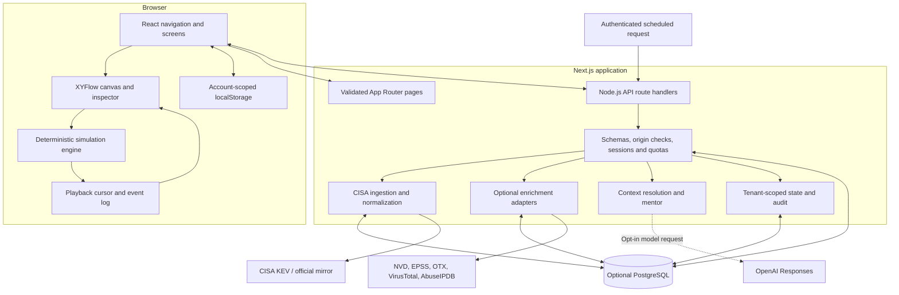
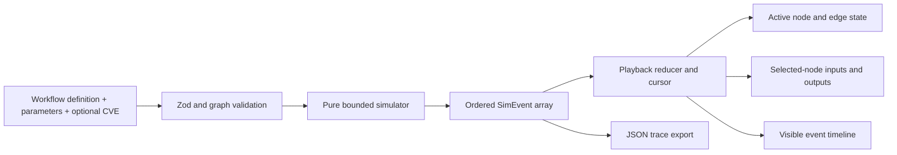
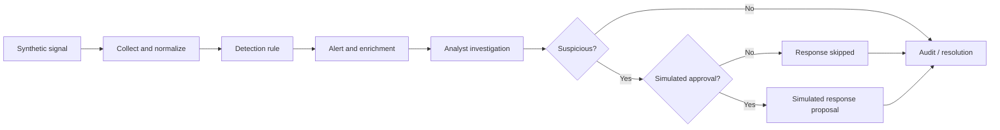
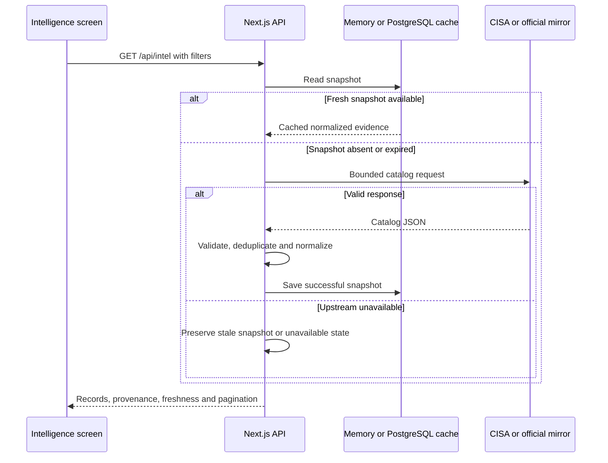
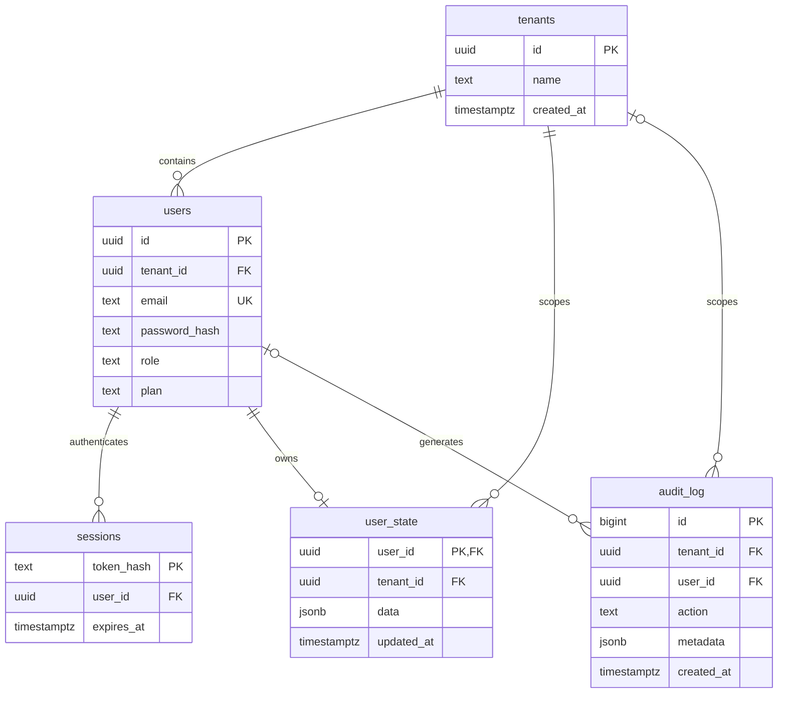
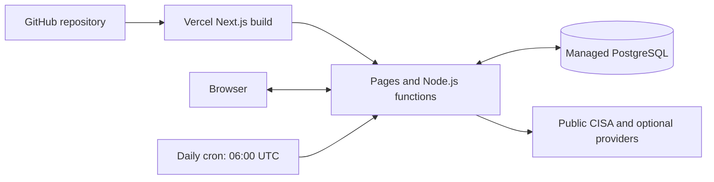

# CYBER AI 2.0

**Learn cybersecurity by watching it work.**

Cyber AI is an interactive cybersecurity learning and investigation application. It combines real public vulnerability intelligence with deterministic educational simulations, contextual lessons, and an automation editor that runs safe, simulated workflows.

**Release status:** working first release built from scratch. Public intelligence is retrieved from CISA; investigation telemetry, asset matches, and response actions are simulated. Optional accounts, model-backed mentoring, and enrichment need configuration. A successful local production build does not mean the application has been deployed.

## Contents

- [What you can do](#what-you-can-do)
- [Quick start](#quick-start)
- [System architecture](#system-architecture)
- [Simulation and automation architecture](#simulation-and-automation-architecture)
- [Intelligence architecture](#intelligence-architecture)
- [Mentor architecture](#mentor-architecture)
- [Storage and database architecture](#storage-and-database-architecture)
- [Security boundaries](#security-boundaries)
- [Project structure](#project-structure)
- [Routes and API](#routes-and-api)
- [Configuration](#configuration)
- [Testing and validation](#testing-and-validation)
- [Deployment](#deployment)
- [Push this project to GitHub](#push-this-project-to-github)
- [Current limits and roadmap](#current-limits-and-roadmap)
- [Documentation and licensing](#documentation-and-licensing)

## What you can do

| Area                        | Working functionality                                                                                                                            |
| --------------------------- | ------------------------------------------------------------------------------------------------------------------------------------------------ |
| Command center              | Source-derived catalog count, actual local learning/run counts, linked investigations                                                            |
| Threat intelligence         | CISA KEV records, official mirror fallback, search, filters, pagination, source details and bookmarks                                            |
| Interactive workflows       | TCP handshake, simplified full TLS 1.3, SOC investigation and CVE investigation                                                                  |
| SOC arena                   | Six synthetic scenarios: cloud identity compromise, phishing, suspicious PowerShell, brute force, possible exfiltration and ransomware precursor |
| Playback and inspection     | Play, pause, step, seek, reset, speed selection, node selection and synchronized inputs/outputs/logs                                             |
| Automation architect        | Add/connect/remove nodes, edit contracts and branch controls, validate graphs, simulate retries/timeouts, save versions and export JSON          |
| Contextual mentor           | Curated local explanations and references; optional server-side model adapter                                                                    |
| Academy                     | Twelve lessons and four learning paths; progress requires workflow completion and a correct quiz answer                                          |
| Saved projects              | Device-local playbooks, version snapshots, bookmarks and completed dry-run history; explicit cloud save/load when configured                     |
| Accounts and administration | Provisioned PostgreSQL users, roles, sessions, tenant-scoped state and tenant audit view                                                         |

### A complete learning journey

1. Open **SOC arena** and choose a scenario.
2. Step through the signal, collection, detection and investigation stages.
3. Select nodes to examine the data transformation and explanation.
4. Change suspicious/normal activity, threshold, enrichment failure or approval parameters.
5. Observe the resulting branch and corresponding event log.
6. Open an automation template and run it with approval withheld, then with simulated approval.
7. Save a version and export the workflow or trace.

For a source-based investigation, open **Threat intelligence**, select a CVE, inspect its evidence, then choose **Open in workflow** or **Automate this**. The selected CVE is preserved through the remediation-review template.

## Quick start

### Requirements

- Node.js 22 or newer and npm; Node.js 24 was used for validation.
- Internet access for dependency installation and public intelligence retrieval.
- PostgreSQL only for accounts, durable state/cache, shared quotas and scheduled ingestion.

From the directory containing `package.json`:

```sh
npm ci
npm run dev
```

Open **http://127.0.0.1:3100**. On Windows, `Start-CyberAI.cmd` also installs missing dependencies and starts the development server.

No API keys are required for guest learning, the local mentor, simulations or browser-local playbooks. Public intelligence requires a successful upstream request; an outage is shown as unavailable/stale.

For production build verification:

```sh
npm run build
npm start
```

The development and local production start commands bind to `127.0.0.1:3100`. Vercel uses its Next.js runtime rather than a persistent local server. Production authentication requires HTTPS because production session cookies are Secure.

## System architecture

The application is one Next.js App Router project, with a browser simulation engine, Node.js API handlers and optional PostgreSQL persistence. It has no separate Python backend, message broker or background worker service.



### Technology choices

| Layer       | Technology                         | Responsibility                                                   |
| ----------- | ---------------------------------- | ---------------------------------------------------------------- |
| Application | Next.js 16 / React 19              | Page routing, UI and server HTTP boundary                        |
| Language    | Strict TypeScript                  | Shared types and implementation                                  |
| Graph UI    | `@xyflow/react`                    | Nodes, edges, selection, dragging, pan/zoom and minimap          |
| Validation  | Zod                                | Workflow, request, provider and model-response schemas           |
| Persistence | PostgreSQL with `pg`               | Parameterized SQL, sessions, state, caches, quotas and audit     |
| Styling     | Plain CSS and Lucide icons         | Responsive dark UI, procedural atmosphere and motion preferences |
| Testing     | Node test runner via `tsx`, PGlite | Engine/security tests and PostgreSQL-engine tests                |
| Tooling     | ESLint, TypeScript, Prettier       | Static checks and formatting                                     |

The lockfile records exact dependency versions. Validation used Next.js 16.4.3. Webpack is used for development/builds; Windows-specific build workers are configured in `next.config.ts`.

## Simulation and automation architecture

### Definition → validation → execution → playback



`src/lib/model.ts` defines the contracts:

| Contract   | Fields / purpose                                                                                            |
| ---------- | ----------------------------------------------------------------------------------------------------------- |
| Workflow   | ID, version, title, domain, summary, nodes, edges and references                                            |
| Node       | ID, operation, explanation, position, required fields, declared outputs, timeout and retries                |
| Edge       | ID, source, target and condition: `always`, `yes` or `no`                                                   |
| Parameters | Scenario, suspicious flag, approval, certificate validity, firewall state, threshold and enrichment failure |
| SimEvent   | ID, index, node ID, deterministic time, input, output, message, status and traversed edge IDs               |

`src/lib/engine.ts` validates unique IDs, valid endpoints, exactly one entry node, reachability, absence of cycles and coherent branch conditions. Definitions are bounded to **50 nodes and 100 edges**. Decision, approval, certificate and SYN operations require explicit yes/no branches.

The processor follows one conditional path. It checks required inputs and declared outputs, clones event data, applies predefined operation semantics and emits ordered events. Given the same definition, parameters and evidence, execution is deterministic. Simulation timestamps are fixed demonstration times, not real observation times.

Playback reveals the generated event sequence. Pausing changes playback state; it does not stop a remote job because no remote job is launched. Parameter changes recompute the deterministic trace.

### Investigation and approval flow



The response operation enforces approval at runtime even if an edited graph bypasses an approval node. It only describes a simulated action. CVE workflows produce remediation proposals; they do not isolate hosts or disable accounts.

### Editor and persistence

The editor supports node placement, connections, conditional edges, required-field editing, retry/timeout settings, validation, version snapshots and JSON export. Timeouts and retries model explicit simulated latency; they do not represent a task queue.

Saved history records completed dry runs. In-session replay uses the recorded portion of the current run. Arbitrary trace import, nested graphs, loops, parallel execution, connector-specific mapping editors and operational connectors are future work.

## Intelligence architecture

`src/server/feeds.ts` fetches CISA KEV from the official endpoint, with the official `cisagov/kev-data` mirror as fallback. Requests have bounded timeouts, response sizes and retries.



The cache lifetime is one hour. Without PostgreSQL, cache state is local to a server process and can disappear on restart or differ across instances. PostgreSQL provides shared durable snapshots.

Normalized records preserve source identity, references, ingestion time, affected products, required action, due date and catalog-addition date. KEV does not supply CVSS, EPSS, first/last observed exploitation or verified ATT&CK mappings; those fields remain null/empty. Catalog addition is not presented as first exploitation. Feed states are `live`, `cached`, `stale` or `unavailable`.

### Optional enrichment

NVD, FIRST EPSS, OTX, VirusTotal and AbuseIPDB are explicit on-demand adapters, not continuous global feeds. Requests require authentication, PostgreSQL quotas, the feature flag and disclosure consent. Keys are needed where required by the provider.

Results are schema-checked, cached for one hour under tenant-scoped keys and interpreted as separate evidence. CVSS, EPSS probability and EPSS percentile are not combined into an invented score. Provider failures do not create a verdict. The supplied implementation uses fixed provider endpoints rather than fetching arbitrary submitted URLs.

## Mentor architecture

`src/server/mentor.ts` resolves the canonical workflow, selected node, topic, playback position and optional CVE server-side. It recomputes the simulation instead of trusting browser-supplied execution output.

1. Validate question and context.
2. Resolve curated explanations and primary references.
3. Produce a working, labeled **local curated mentor** answer.
4. If the user opts into the model and configuration is present, enforce authentication/shared quotas and call OpenAI Responses.
5. Validate the structured model output and citation IDs; use local guidance if the model response is unavailable or unsuitable.

The model path uses `store:false`, no tools and no automation execution authority. Source text is treated as untrusted context. Answers contain an explanation, limitations, next steps and allowed citations. These constraints reduce risk; they do not establish perfect prompt-injection resistance or factual accuracy.

The local mode is deterministic teaching content, not a language model. The model-backed path was not live-tested with credentials in the initial validation.

## Storage and database architecture

### Browser state

`src/components/store.tsx` stores completed lessons, bookmarks, workflow versions and history under `cyber-ai:<user-id>` or `cyber-ai:guest`. Motion preference is stored separately. Cloud save/load is an explicit user action, not continuous synchronization.

### PostgreSQL model

The migration in `db/migrations/001_initial.sql` creates the following relationships:



Shared operational tables are separate from the relational account model:

| Table             | Key and responsibility                                                                       |
| ----------------- | -------------------------------------------------------------------------------------------- |
| `provider_cache`  | Text key → JSON snapshot/result and update time; optional lookup keys include tenant context |
| `provider_health` | Provider → status, last attempt, last success and safe message                               |
| `rate_buckets`    | Quota key → count and expiry; atomic SQL updates support shared rate limits                  |

Tenant isolation is enforced by application queries using the session-derived tenant/user. The supplied migration does **not** enable PostgreSQL row-level security. User-state reads filter by both identities; writes prevent a conflicting tenant from updating an existing user's row.

Sessions expire after 12 hours. Scheduled cleanup removes expired sessions/rate buckets and lookup cache older than seven days. Audit logs and user state have no automatic retention deletion; operators must define that policy.

### Database setup

Copy `.env.example` to `.env.local` and configure `DATABASE_URL`:

```powershell
Copy-Item .env.example .env.local
npm run db:migrate
```

Set a unique `SEED_ADMIN_EMAIL` and `SEED_ADMIN_PASSWORD` of at least 14 characters in that local environment file, then run:

```sh
npm run db:seed
```

The seed provisions an administrator and refuses to overwrite an existing account. Remove seed credentials afterwards. There is no default password, self-service registration, password recovery, invitation system or MFA.

## Security boundaries

- API keys and database credentials are read only on the server; never place them in `NEXT_PUBLIC_*` variables.
- Passwords use salted scrypt; comparison is timing-safe. Opaque session tokens contain 256 random bits and are stored as hashes.
- Cookies are HttpOnly, SameSite=Strict and Secure in production; production uses the `__Host-` cookie prefix.
- POST requests require an allowed origin. Set `APP_ORIGIN` to the exact deployed HTTPS origin; production requests fail closed without it.
- JSON bodies are bounded to 150,000 bytes. Zod checks request shapes, graph definitions and external data.
- Admin and authenticated operations check access on the server. Tenant identifiers in request bodies do not determine authorization.
- Optional external lookups and model usage require shared database quotas. Account plan limits exist, but billing/checkout is not implemented.
- Indicator validation rejects unsupported formats and private/reserved IPv4 addresses. IPv6 lookup is not supported.
- Security headers deny framing and restrict resources. The current CSP permits inline scripts/styles and script evaluation; nonce-based hardening remains future work.
- No real network scanning, exploitation, private telemetry ingestion, containment, arbitrary script execution or external notifications are implemented.

## Project structure

```text
cyber-ai/
├── src/
│   ├── app/
│   │   ├── [[...path]]/page.tsx       # Page allowlist and route validation
│   │   ├── api/[...segments]/route.ts # HTTP dispatch, schemas and access checks
│   │   ├── layout.tsx                # Metadata and global layout
│   │   ├── globals.css               # Responsive design and motion settings
│   │   ├── not-found.tsx
│   │   └── icon.svg
│   ├── components/
│   │   ├── App.tsx                   # Shell, navigation and dashboard
│   │   ├── Workspace.tsx             # Canvas, editor, playback and inspector
│   │   ├── Intel.tsx                 # Catalog, evidence and enrichment UI
│   │   ├── Screens.tsx               # Universe, academy, projects, settings, admin
│   │   └── store.tsx                 # Local state, API helper and JSON exports
│   ├── lib/
│   │   ├── model.ts                  # Shared Zod contracts and types
│   │   ├── engine.ts                 # Pure simulation and playback logic
│   │   └── content.ts                # Workflows, lessons, quizzes and references
│   └── server/
│       ├── db.ts                     # PostgreSQL pool, cache, health and audit
│       ├── state.ts                  # Tenant/user-scoped state queries
│       ├── security.ts               # Sessions, origin checks, quotas, validation
│       ├── feeds.ts                  # CISA ingestion and normalization
│       ├── providers.ts              # Optional on-demand enrichment
│       └── mentor.ts                 # Context and local/model mentoring
├── db/migrations/001_initial.sql
├── scripts/                          # Migration, seed, feed checks and exports
├── tests/                            # Engine, security and database tests
├── fixtures/                         # Generated synthetic definitions/traces
├── docs/                             # Detailed architecture/API/deployment records
├── licenses/                         # Dependency inventory and notices
├── .env.example                      # Placeholder settings only
├── .gitignore
├── Start-CyberAI.cmd
├── next.config.ts
├── vercel.json
├── package.json
└── package-lock.json
```

## Routes and API

### Application routes

| Route                                                                | Purpose                                                  |
| -------------------------------------------------------------------- | -------------------------------------------------------- |
| `/`, `/dashboard`                                                    | Command center                                           |
| `/intel`, `/intel/<CVE-ID>`                                          | Intelligence catalog and record detail                   |
| `/universe`                                                          | Connected knowledge navigator                            |
| `/workflow/tcp`, `/workflow/tls`, `/workflow/soc`, `/workflow/intel` | Workflow workspaces                                      |
| `/soc`                                                               | Scenario arena                                           |
| `/automation`                                                        | Dry-run workflow editor                                  |
| `/academy`, `/learn/<topic>`                                         | Learning paths and lessons                               |
| `/projects`                                                          | Saved versions, bookmarks and history                    |
| `/settings`                                                          | Accounts, cloud save/load, providers and motion settings |
| `/admin`                                                             | Admin UI; data endpoint is server-protected              |

Unknown routes/topics/workflows return 404.

### API endpoints

| Method / endpoint         | Access                                                             | Purpose                                                             |
| ------------------------- | ------------------------------------------------------------------ | ------------------------------------------------------------------- |
| GET `/api/health`         | Public                                                             | Version/configuration status; does not verify a database connection |
| GET `/api/intel`          | Public                                                             | Filters `q`, `since`, `severity`, `page`; 24 records per page       |
| GET `/api/intel/<CVE-ID>` | Public                                                             | Normalized source record and freshness                              |
| GET `/api/providers`      | Public                                                             | Provider configuration/health without secrets                       |
| GET `/api/auth/session`   | Public                                                             | Current user or null                                                |
| POST `/api/auth/login`    | Trusted origin, rate-limited                                       | Provisioned account sign-in                                         |
| POST `/api/auth/logout`   | Trusted origin                                                     | Revoke session                                                      |
| GET / POST `/api/state`   | Signed in; POST origin checked                                     | Read/save own learning state                                        |
| POST `/api/mentor`        | Origin checked; model mode requires account/quotas when configured | Contextual explanation                                              |
| POST `/api/lookup`        | Signed in, enabled, consented                                      | Explicit provider enrichment                                        |
| GET `/api/admin`          | Admin                                                              | Current tenant's recent audit events                                |
| GET `/api/cron/ingest`    | Bearer secret and PostgreSQL                                       | Ingestion and bounded cleanup                                       |

JSON responses use `Cache-Control: private, no-store`; this is independent of server-side provider caching. See [API.md](docs/API.md) for payloads and source references.

## Configuration

| Variable                                   | Purpose                                                                              |
| ------------------------------------------ | ------------------------------------------------------------------------------------ |
| `APP_ORIGIN`                               | Trusted browser origin; local: `http://127.0.0.1:3100`; deployed: exact HTTPS origin |
| `DATABASE_URL`                             | PostgreSQL connection for accounts, persistence, shared quotas and cron              |
| `CRON_SECRET`                              | At least 32 characters; authenticates scheduled ingestion                            |
| `OPENAI_API_KEY`                           | Optional server-side model credential                                                |
| `OPENAI_MODEL`                             | Model supporting the adapter's Responses structured-output request                   |
| `ENABLE_EXTERNAL_LOOKUPS`                  | Defaults to false; set true to allow authenticated enrichment                        |
| `NVD_API_KEY`                              | Optional NVD key                                                                     |
| `OTX_API_KEY`                              | Optional OTX credential                                                              |
| `VIRUSTOTAL_API_KEY`                       | Optional VirusTotal credential                                                       |
| `ABUSEIPDB_API_KEY`                        | Optional AbuseIPDB credential                                                        |
| `SEED_ADMIN_EMAIL` / `SEED_ADMIN_PASSWORD` | Provisioning only; remove after seed                                                 |
| `SEED_TENANT_NAME`                         | Initial workspace name                                                               |

Never commit `.env.local` or other real environment files. The repository ignores `.env*` except `.env.example`.

## Testing and validation

```sh
npm run typecheck
npm run lint
npm test
npm run build
```

Additional checks:

```sh
npm run verify:feeds
npm run test:api
npm audit --omit=dev
```

`test:api` requires a running server at `http://127.0.0.1:3100` by default; `TEST_BASE_URL` can target another origin. It expects an environment that permits the public curated mentor and live feed checks. Public-feed checks depend on upstream availability.

| Check                                       | Initial validation result                                                     |
| ------------------------------------------- | ----------------------------------------------------------------------------- |
| TypeScript, ESLint and production build     | Passed                                                                        |
| Engine/security/database suite              | 23 tests passed                                                               |
| Local development HTTP smoke checks         | 25 checks passed                                                              |
| Database engine                             | Actual migration and queries exercised with PGlite                            |
| Public sources                              | CISA/mirror, NVD and FIRST EPSS connectivity checked                          |
| Keyed providers and model requests          | Not live-tested with credentials                                              |
| Managed PostgreSQL / Vercel deployment      | Not deployed or integration-tested                                            |
| Browser review                              | Dashboard, graph, step-through events, approval skip and local mentor checked |
| Full mobile/accessibility/performance audit | Outstanding                                                                   |

Results were recorded on **24 October 2026**; they are not a claim that GitHub CI has run. See [VALIDATION.md](docs/VALIDATION.md) for the evidence and limits. No GitHub Actions workflow is included in this release.

Developer utilities: `npm run fixtures` regenerates synthetic exports, `npm run format` formats supported source files, and `node scripts/licenses.mjs` rebuilds installed dependency notices.

## Deployment

### Vercel topology



1. Push this project with `package.json` at the repository root, then import the repository into Vercel.
2. Select the Next.js preset, a supported Node.js version matching the project, install command `npm ci`, and build command `npm run build`. Do not select static export.
3. Configure `APP_ORIGIN` for the actual deployment origin. Configure PostgreSQL and secrets for the capabilities being enabled.
4. Run migration and admin provisioning from a trusted environment. Use pooling/TLS as required by the managed database.
5. Deploy and verify public pages, source freshness, sign-in, state save/load, access failures and cron ingestion.
6. `vercel.json` declares a daily `0 6 * * *` request to `/api/cron/ingest`. Confirm scheduler availability for your hosting plan and configure the bearer secret.
7. Set backup, monitoring and retention policies for persistent data.

There is no persistent process, WebSocket service or worker queue. Without PostgreSQL, process-local caches are unsuitable as durable ingestion storage. See [DEPLOYMENT.md](docs/DEPLOYMENT.md) for environment, verification and rollback details.

## Push this project to GitHub

Destination: [kushalshrestha303-web/CyberAI](https://github.com/kushalshrestha303-web/CyberAI).

Use the **project folder containing this README and package.json**, not its parent ZIP folder. Authenticate Git with an account that can write to the destination.

For a newly extracted ZIP, initialize Git if it is not already a repository:

```sh
git init -b main
git add .
git status --short
git commit -m "Initial Cyber AI 2.0 release"
```

Review the staged list before committing. The supplied `.gitignore` excludes dependencies, build output, logs and real environment files. It does not remove a secret that was previously committed.

Connect an empty destination repository and push:

```sh
git remote add origin https://github.com/kushalshrestha303-web/CyberAI.git
git push -u origin main
```

If `origin` already exists, inspect `git remote -v` first. Only when it is the wrong destination, update it with:

```sh
git remote set-url origin https://github.com/kushalshrestha303-web/CyberAI.git
```

If the remote already has commits, fetch and review its history before integrating it; do not force-push over existing work. A 403/permission error means the authenticated account lacks access. Do not put tokens or passwords in repository URLs or README files.

## Current limits and roadmap

This first release implements a bounded educational product. The following are not complete:

- Production telemetry connectors, asset inventory, external response execution or notifications.
- Sentinel, Defender, Graph, Wazuh, Splunk, Elastic, Slack or Teams operational adapters.
- Arbitrary model-generated graphs, SIEM query execution, file uploads or trace import.
- Parallel/nested workflow execution, loops, background workers and connector mapping editors.
- Self-service identity lifecycle, password recovery, invitations, SSO or MFA.
- Paid checkout, billing enforcement tied to payments, and commercial entitlement management.
- Full device/accessibility/security/load audits and comprehensive monitoring/retention controls.

Priorities and extension paths are described in [ROADMAP.md](docs/ROADMAP.md). Learning progress is educational feedback, not a certification. Provider usage remains subject to each provider's terms and limits.

## Documentation and licensing

- [Architecture and implementation map](docs/ARCHITECTURE.md)
- [API contracts and provider references](docs/API.md)
- [Deployment and operations](docs/DEPLOYMENT.md)
- [Validation record](docs/VALIDATION.md)
- [Commercial expansion roadmap](docs/ROADMAP.md)
- [Changelog](CHANGELOG.md)
- [Third-party attribution](THIRD_PARTY_LICENSES.md)
- [Dependency notices](licenses/DEPENDENCY_NOTICES.md)

An open-source license for the original application has not been selected. Publishing a public repository does not itself grant an open-source license. Third-party dependencies retain their own licenses, and external data retains its source terms.
